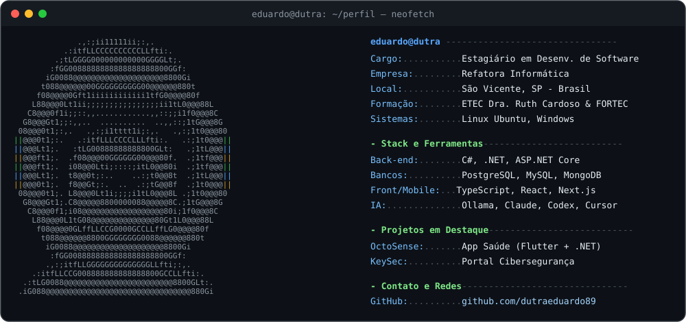

 

Desenvolvedor de Software | Back-end | .NET

GitHub · LinkedIn

Perfil

Atualmente atuo como estagiário em Desenvolvimento de Software na Refatora Informática. Tenho foco em desenvolvimento back-end com C# e .NET, construção de APIs REST, integração com bancos de dados e exploração de inteligência artificial aplicada ao desenvolvimento de software.

Também trabalho com tecnologias de front-end e desenvolvimento mobile, buscando ampliar minha experiência na construção de aplicações completas.

Informação	Detalhes
Cargo	Estagiário em Desenvolvimento de Software
Empresa	Refatora Informática
Localização	São Vicente, SP — Brasil
Formação	ETEC Dra. Ruth Cardoso e FORTEC
Sistemas	Linux Ubuntu e Windows
Tecnologias

Back-end

Front-end e Mobile

Bancos de dados

Ferramentas e ambiente

Outras ferramentas: ASP.NET Core, APIs REST, Ollama, Claude, Codex e Cursor.

Projetos

OctoSense

Aplicativo Android integrado ao Health Connect para leitura de dados de sensores de smartwatches e geração de insights utilizando inteligência artificial local.

Tecnologias: C#, .NET, Flutter, MongoDB e Ollama.

Repositório: octosense-open-source

KeySec

Plataforma educativa voltada à cibersegurança e conscientização digital, com assistente interativo baseado em regras e estruturas JSON.

Tecnologias: Next.js, React, JavaScript e CSS Modules.

Repositório: keysec-project

Métricas do GitHub

Contato

 

